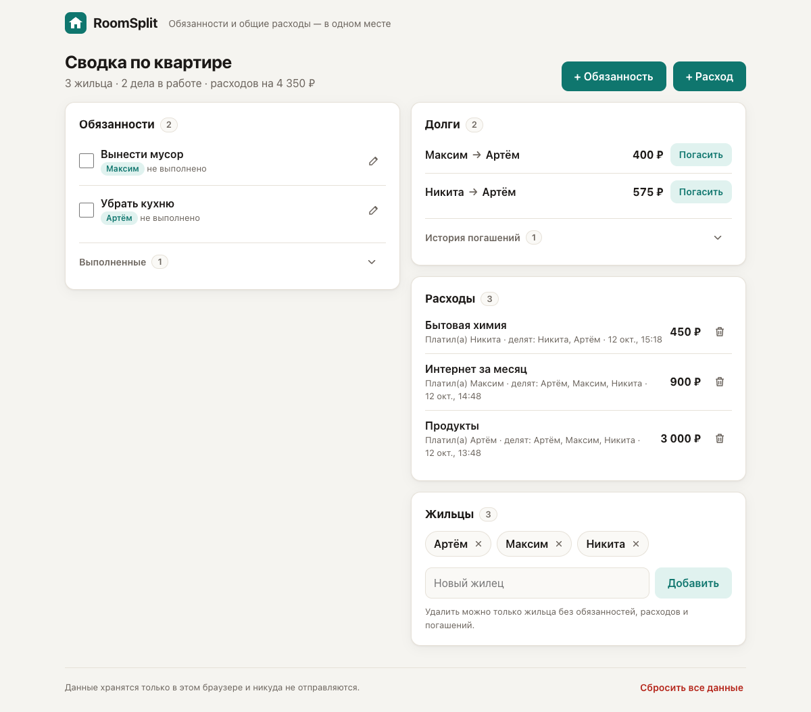
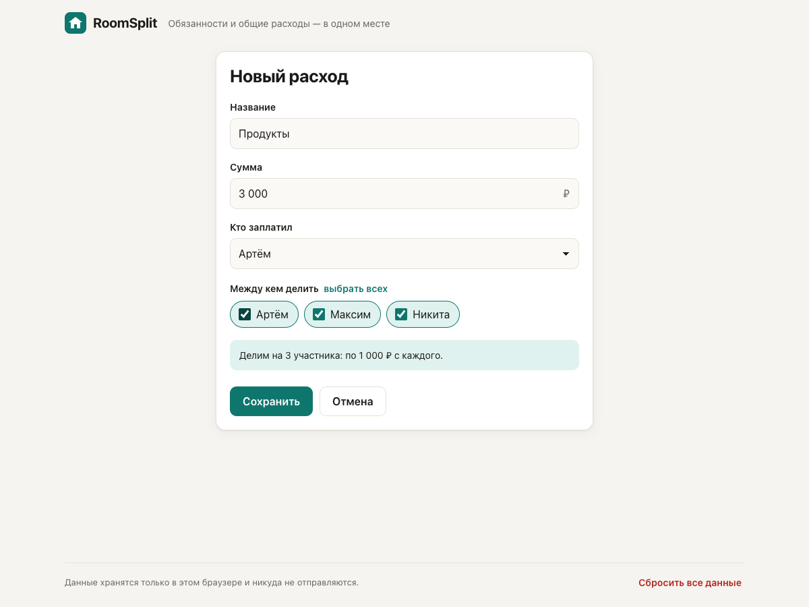
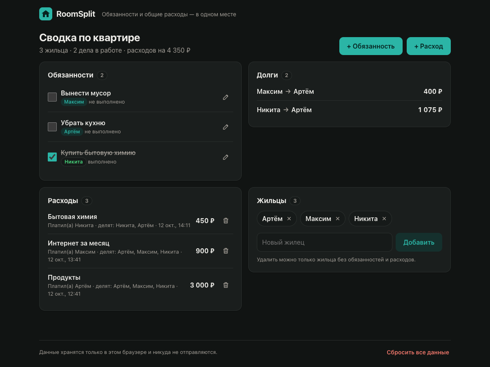
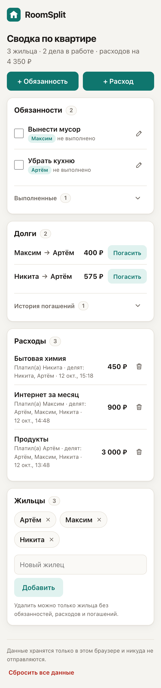

# RoomSplit

> **English summary.** A web app for flatmates: shared chores, shared expenses and automatic
> "who owes whom" calculation, with debts recomputed across all expenses down to the kopeck.
> No sign-up or server: the state lives in the browser's LocalStorage.
> Plain HTML/CSS/JavaScript, about 1,000 lines of `node --test` tests, CI and deployment to GitHub Pages.
> **Live demo:** https://porphyras.github.io/roomsplit/
>
> **My role.** A team project from a university course. I wrote all of the code, designed the MVP
> architecture and wrote the technical specification ([docs](docs/)).

**Обязанности и общие расходы — в одном месте.**

### 👉 Открыть приложение: **https://porphyras.github.io/roomsplit/**
### 📖 [Инструкция пользователя](docs/USER_MANUAL.md)

[](https://github.com/porphyras/roomsplit/actions/workflows/ci.yml)

RoomSplit — веб-приложение для людей, которые живут вместе. Оно помогает распределять домашние обязанности, учитывать общие покупки и автоматически считает, кто кому сколько должен. Не нужны ни регистрация, ни установка: открываете ссылку и пользуетесь.



---

## Как проверить за 2 минуты

1. Откройте [ссылку на приложение](https://porphyras.github.io/roomsplit/).
2. **Быстрый вариант:** нажмите «Посмотреть на демо-данных» — появится квартира из бизнес-гипотезы (Артём, Максим, Никита) с обязанностями, расходами, долгами и одним частичным погашением.
3. **Сценарий демонстрации из ТЗ (п. 5.3):**
   1. добавьте жильцов: Артём, Максим, Никита → «Продолжить»;
   2. «+ Обязанность»: «Вынести мусор», ответственный Максим → поставьте галочку «выполнено»;
   3. «+ Расход»: «Продукты», 3000 ₽, заплатил Артём, делим на троих → в «Долгах»: **Максим → Артём 1 000 ₽, Никита → Артём 1 000 ₽**;
   4. добавьте ещё один расход (например, «Интернет», 900 ₽, заплатил Максим) → долги пересчитаются по всем расходам: **Максим → Артём 400 ₽, Никита → Артём 1 300 ₽**;
   5. обновите страницу (F5) → все данные на месте;
   6. *(сверх ТЗ)* нажмите «Погасить» у долга Никиты, укажите 300 ₽ → останется **Никита → Артём 1 000 ₽**; погашение видно в «Истории погашений», его можно удалить корзиной.
4. «Сбросить все данные» внизу страницы возвращает приложение к первому запуску.

> Данные хранятся в LocalStorage **вашего** браузера (так задано в архитектуре MVP). У каждого проверяющего своя «квартира», и чужие данные никто не видит и не испортит.

---

## Функции MVP

| Функция из бизнес-гипотезы | Что реализовано |
|---|---|
| **№1. Управление обязанностями** | создание задачи, выбор ответственного, статус «не выполнено / выполнено» (галочкой или в форме), редактирование, удаление; выполненные уходят в свёрнутую историю |
| **№2. Расходы и расчёт долгов** | название, сумма, плательщик, участники; поровну до копейки; долги пересчитываются по всем расходам; у каждого расхода видно, сколько по нему ещё ждут возврата |
| **№3. Общая сводка** | текущие обязанности, ответственные и долги на одном экране |

Дополнительно, сверх ТЗ (небольшие доработки, без которых MVP неудобно показывать):

- **погашение долгов**: кнопка «Погасить» у каждого долга, можно вернуть часть суммы (но не больше долга); возвраты складываются в свёрнутую «Историю погашений», ошибочный удаляется корзиной, после погашения можно нажать «Отменить». Если удалить расход, по которому уже возвращали деньги, эти погашения отменяются вместе с ним (приложение заранее предупреждает), иначе появились бы обратные долги. В ТЗ «отметка погашения долга» стояла в планах на будущее, но без неё долги в живом использовании только растут;
- **закрытие расходов**: расход сам уходит в свёрнутые «Закрытые расходы», когда все участники вернули свои доли (деньгами или встречными долгами). Возвраты засчитываются в самые старые расходы. Сумма «ждёт возврата» по всем открытым расходам всегда равна сумме текущих долгов;
- **удаление ошибочного расхода** с подтверждением: без него опечатка в сумме навсегда искажает долги;
- **добавление жильцов после первого запуска**; удалить можно только жильца без задач и расходов (правило блокировки из ТЗ 2.3);
- **кнопка демо-данных** для быстрой проверки;
- **предпросмотр деления** в форме расхода («по 1 000 ₽ с каждого»);
- **компактная сводка при долгом использовании**: на главной остаются только невыполненные обязанности, выполненные складываются в историю (свёрнута, новые сверху, по 10 штук, с датой выполнения, можно вернуть в работу); после галочки можно нажать «Отменить»; из расходов показываются последние 5 и кнопка «Показать все». Колонки независимы, поэтому длинный список дел не сдвигает долги и расходы.

Чего в MVP нет и не должно быть (по ТЗ): регистрации, аккаунтов, сервера, синхронизации, уведомлений, платёжных систем (погашение — это только отметка «вернул», деньги приложение не переводит).

<p>
  
  
</p>
<p align="center"></p>

---

## Архитектура

Клиентское веб-приложение на HTML + CSS + чистом JavaScript, без фреймворков и внешних зависимостей. Состояние хранится одним JSON-объектом в LocalStorage под ключом `roomsplit_state_v1`.

```
Интерфейс (app.js) ──ввод──▶ Валидация ──▶ Сервисы бизнес-логики ──▶ AppState ──JSON──▶ LocalStorage
        ▲                                   Task / Expense / Resident                 ◀──────────
        └──────── результат / ошибки ────── Debt Calculator, Summary
```

| Файл | Роль |
|---|---|
| [`index.html`](index.html), [`css/styles.css`](css/styles.css) | разметка 4 экранов (первый запуск, сводка, форма обязанности, форма расхода), адаптивная вёрстка, тёмная тема |
| [`js/config.js`](js/config.js) | константы и тексты всех кодов ошибок |
| [`js/errors.js`](js/errors.js) | единый формат ошибки `{ code, message, field }` |
| [`js/validation.js`](js/validation.js), [`js/money.js`](js/money.js) | нормализация ввода, перевод сумм в копейки и форматирование |
| [`js/state.js`](js/state.js) | модель `AppState`, проверка структуры и ссылочной целостности |
| [`js/storage.js`](js/storage.js) | `loadState` / `saveState`, защита от затирания повреждённых данных |
| [`js/resident-service.js`](js/resident-service.js), [`js/task-service.js`](js/task-service.js), [`js/expense-service.js`](js/expense-service.js) | бизнес-правила жильцов, обязанностей и расходов |
| [`js/debt-calculator.js`](js/debt-calculator.js) | алгоритм расчёта долгов |
| [`js/payment-service.js`](js/payment-service.js) | погашение долгов (сверх ТЗ): проверка суммы, удаление погашения |
| [`js/summary-service.js`](js/summary-service.js) | сборка общей сводки |
| [`js/store.js`](js/store.js) | связка «валидация → изменение → сохранение» с откатом при ошибке записи |
| [`js/app.js`](js/app.js) | интерфейс и навигация |

### Модель данных

```js
AppState { schemaVersion: 2, residents: Resident[], tasks: Task[], expenses: Expense[], payments: Payment[] }
Resident { id, name }
Task     { id, title, assigneeId, status: "pending" | "completed", createdAt, completedAt? }
Expense  { id, title, amountKopecks, payerId, participantIds[], createdAt }
Payment  { id, fromId, toId, amountKopecks, createdAt }  // погашение, сверх ТЗ
Debt     { debtorId, creditorId, amountKopecks }   // не хранится, считается из расходов и погашений
```

### Алгоритм расчёта долгов (ТЗ 3.2)

1. Баланс каждого жильца = 0.
2. Каждый расход делится поровну: `floor(сумма / N)` каждому участнику, остаток копеек раздаётся по одной, начиная с первого участника. Сумма долей всегда равна сумме расхода.
3. Плательщику прибавляется вся сумма, каждому участнику вычитается его доля. Плюс означает «ему должны», минус — «он должен».
4. Погашение (сверх ТЗ) работает как обратный перевод: вернувшему прибавляется сумма, получившему вычитается.
5. Должники и кредиторы попарно гасят балансы, пока все не станут нулём. Нулевых долгов и долгов самому себе не бывает.

Все вычисления идут в целых копейках, поэтому ошибок округления нет.

### Обработка ошибок

- Неверный ввод не меняет данные, сообщение появляется рядом с полем. Если ошибок несколько, показываются все сразу.
- Если браузер не дал записать данные, изменение откатывается и пользователь видит сообщение.
- Повреждённые данные в LocalStorage не затираются: они копируются в резервный ключ `roomsplit_state_v1_backup_<время>`, о чём сообщает баннер.
- Пользовательский текст выводится только как текст (`textContent`), так что HTML в именах не исполняется.

Коды ошибок из ТЗ: `RESIDENT_NAME_REQUIRED`, `RESIDENT_NAME_DUPLICATE`, `TASK_TITLE_REQUIRED`, `TASK_NOT_FOUND`, `RESIDENT_NOT_FOUND`, `INVALID_STATUS`, `EXPENSE_TITLE_REQUIRED`, `AMOUNT_INVALID`, `PARTICIPANTS_EMPTY`, `PAYER_NOT_IN_PARTICIPANTS`, `INVALID_EXPENSE_DATA`, `STATE_PARSE_ERROR`, `STATE_INVALID`, `STORAGE_WRITE_ERROR`. Дополнительные, для функций сверх ТЗ и лимитов: `RESIDENT_NAME_TOO_LONG`, `RESIDENTS_LIMIT`, `RESIDENT_IN_USE`, `TASK_TITLE_TOO_LONG`, `EXPENSE_TITLE_TOO_LONG`, `EXPENSE_NOT_FOUND`, `AMOUNT_TOO_LARGE`, `STORAGE_UNAVAILABLE`, `DEBT_NOT_FOUND`, `PAYMENT_EXCEEDS_DEBT`, `PAYMENT_NOT_FOUND`.

Версия схемы данных поднята до 2 (добавлены погашения). Данные версии 1 из браузера обновляются автоматически при загрузке.

---

## Тесты

73 unit-теста на встроенном `node:test`, без зависимостей:

- расчёт долгов: пример из ТЗ, несколько расходов от разных плательщиков, взаимное погашение, деление копеек, случайные данные (300 прогонов: сумма долгов всегда сходится с балансами);
- разбор сумм («3 000», «1500,5», «99.99 ₽»), понятные сообщения об ошибках суммы и форматирование;
- валидация и коды ошибок всех сервисов, история выполненных обязанностей;
- погашения: частичное и полное, запрет переплаты, удаление погашения; удаление расхода, по которому уже возвращали деньги (300 случайных прогонов: удаление не создаёт переплат);
- хранилище: повреждённые данные, ошибка записи с откатом, миграция данных v1 → v2, сценарий демонстрации с «перезагрузкой страницы».

```bash
npm test
```

### Проверка на устойчивость

Кроме unit-тестов приложение проверялось в браузерах Chrome, Firefox и Safari (WebKit) сквозными сценариями и исследовательским тестированием «как пользователь, который пытается всё сломать»:

- двойной клик по «Сохранить» и «Погасить», двойной Enter — дублей не создаётся;
- две открытые вкладки — изменения одной не затираются другой, вторая вкладка сразу видит новые данные;
- имена из невидимых символов, «Артём» и «Артем», HTML и эмодзи в названиях, слова по 40–80 букв без пробелов на экране телефона;
- суммы: пусто, ноль, минус, буквы, `1e5`, `10,999`, 17 девяток, переплата долга;
- все вернули долги — расход закрывается сам; если его всё же удалить — обратных долгов не появляется;
- переполненное и запрещённое хранилище (приватный режим), восемь видов повреждённых данных;
- 250 случайных действий подряд без единой ошибки JavaScript.

Тесты запускаются в GitHub Actions при каждом изменении. Сайт публикуется на GitHub Pages **только если все тесты прошли**, поэтому сломанная версия не попадёт к пользователям.

## Запуск локально

Сборка не нужна. Можно просто открыть `index.html` в браузере или поднять локальный сервер:

```bash
npm start          # http://localhost:8080
```

Поддерживаются актуальные версии Chrome, Firefox, Edge и Safari, в том числе мобильные.

## Документация

- [Инструкция пользователя](docs/USER_MANUAL.md): пошагово, со скриншотами, ошибки и FAQ
- [Бизнес-гипотеза](docs/RoomSplit_Бизнес-гипотеза.docx)
- [Архитектура и ТЗ](docs/RoomSplit_Чек-лист_архитектура_Участник_2.docx)
