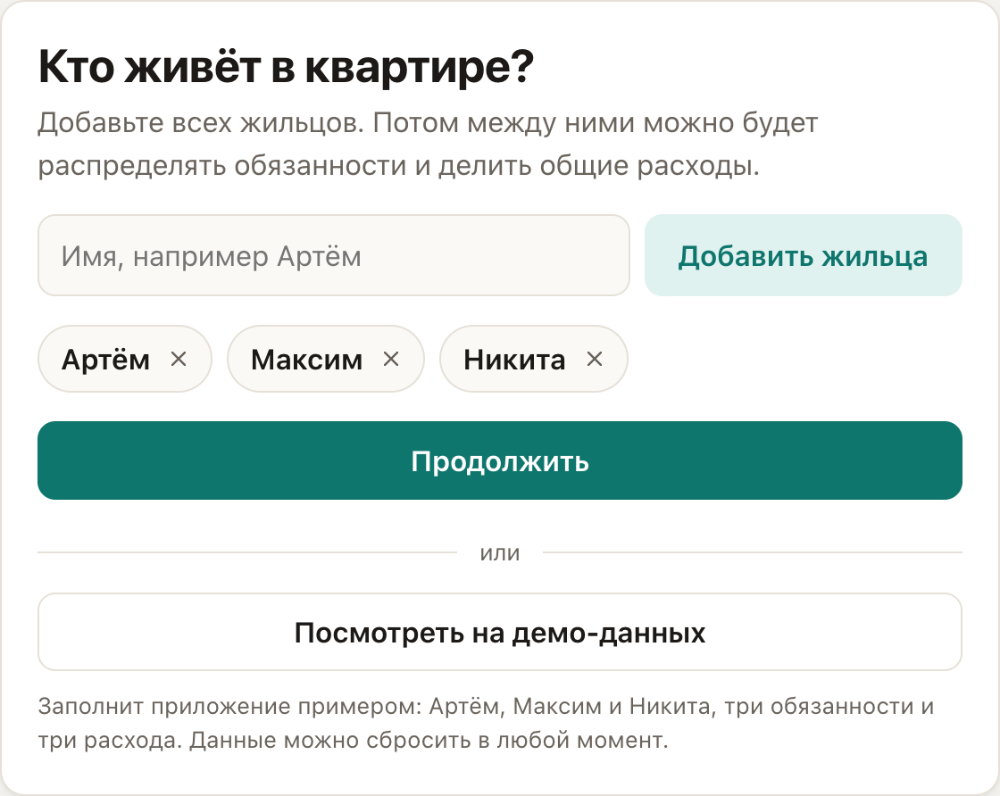
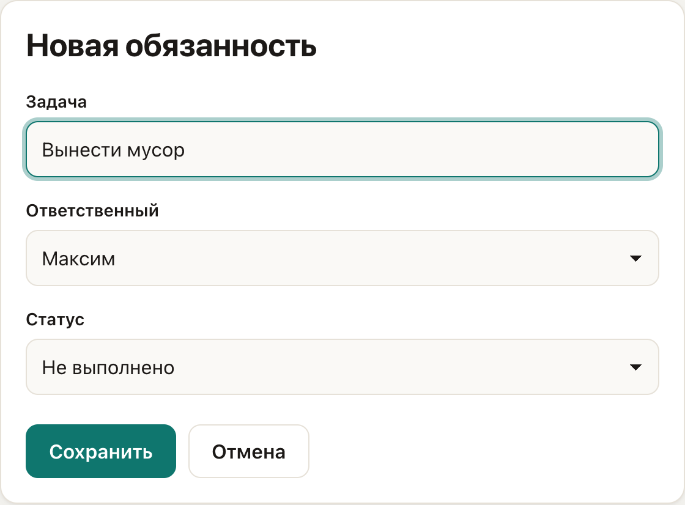
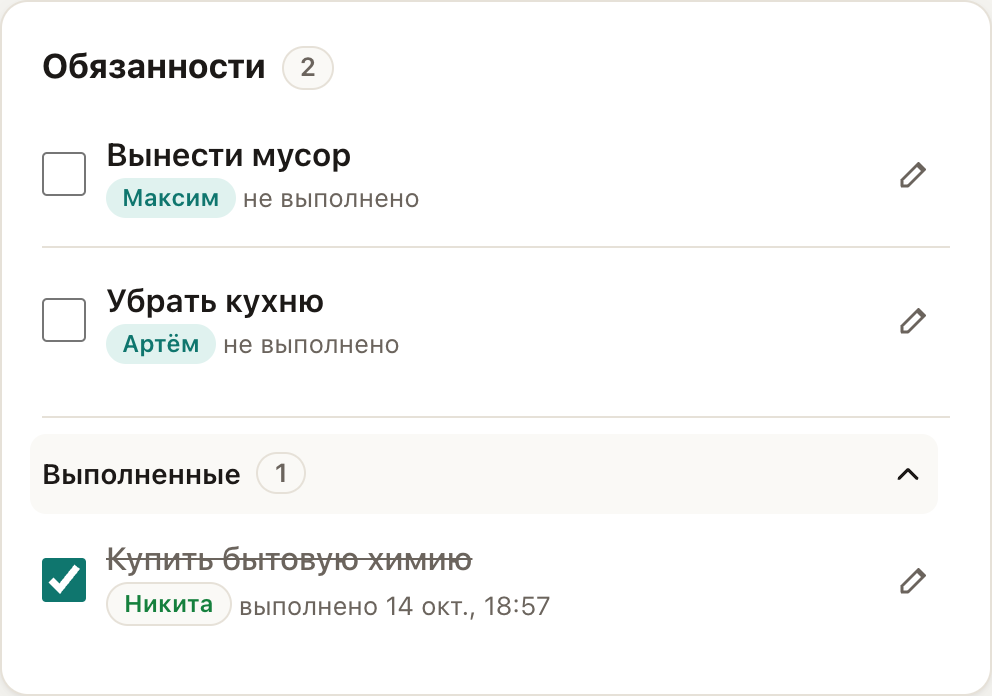
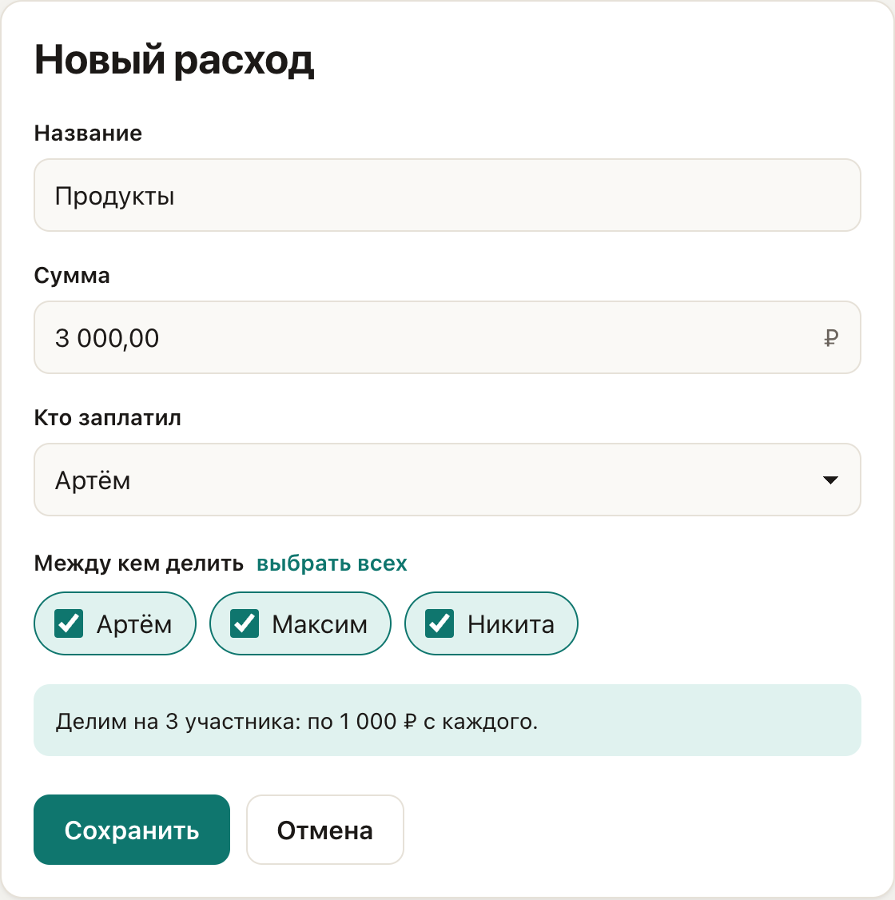
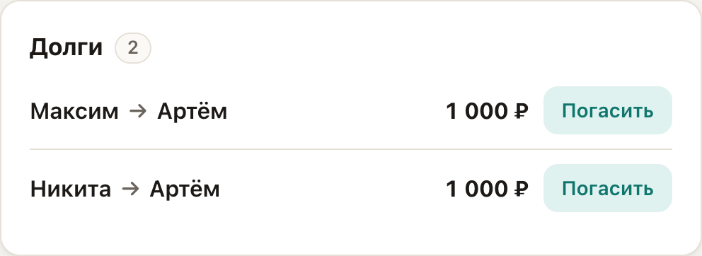
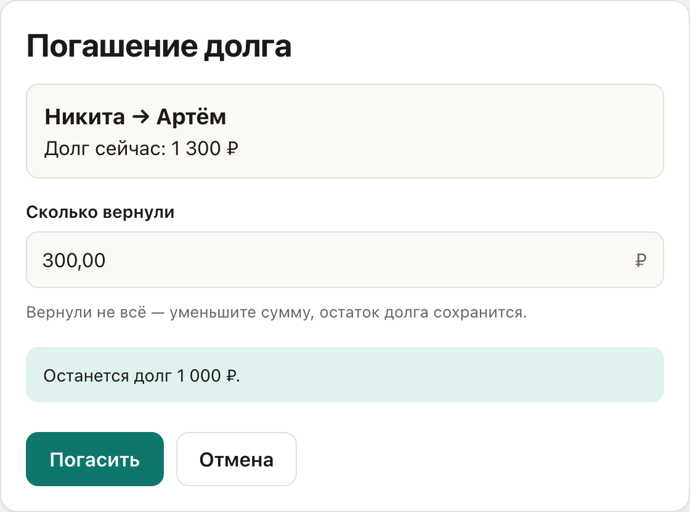
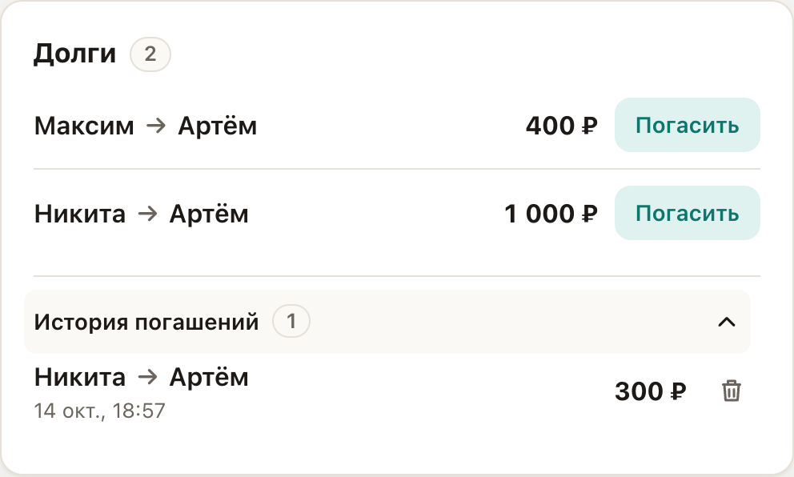
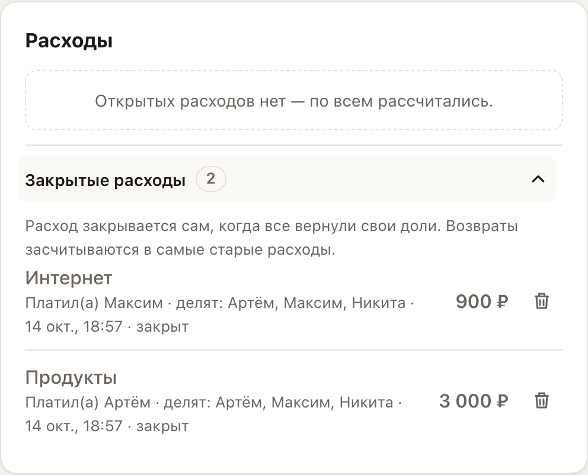
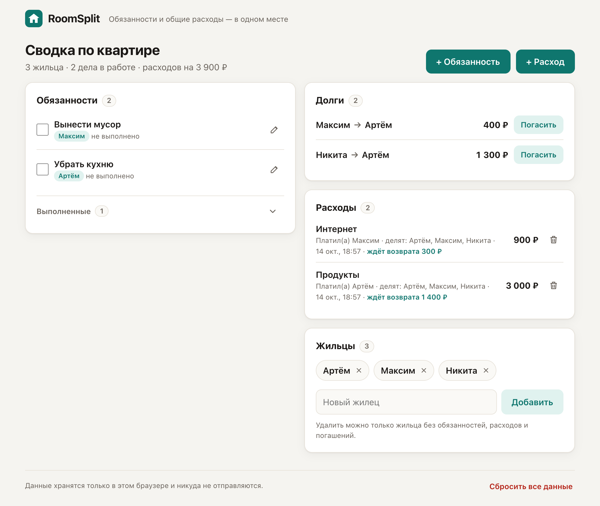
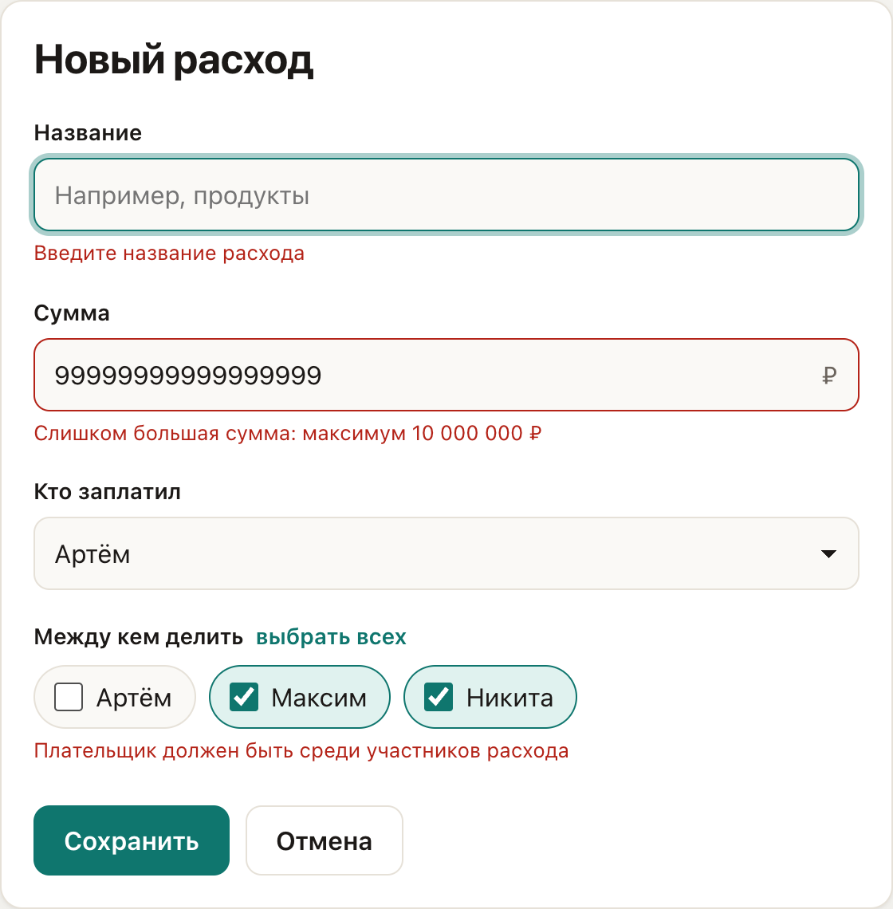

# ИНСТРУКЦИЯ ПОЛЬЗОВАТЕЛЯ RoomSplit (пошаговое руководство)

## 0. ВВЕДЕНИЕ

* **Название проекта:** RoomSplit — «Обязанности и общие расходы — в одном месте».
* **Ссылка на работающий MVP:** **https://puoku.github.io/roomsplit/** (работает круглосуточно, установка и регистрация не нужны).
* **Исходный код:** https://github.com/puoku/roomsplit
* **Для кого этот продукт:** для людей, которые живут вместе: студентов на съёмной квартире, соседей по общежитию, друзей, пар. Особенно для групп из 2–4 человек, у которых много общих покупок и бытовых дел.
* **Что он делает:** помогает распределить домашние обязанности, записать общие расходы и **автоматически посчитать, кто кому сколько должен**. Всё видно на одном экране.
* **Сколько времени займёт знакомство:** 2–3 минуты до первого автоматически посчитанного долга. Если нажать «Посмотреть на демо-данных», хватит 10 секунд.

---

## 1. ПЕРВЫЙ ВХОД В ПРОДУКТ

* **Как попасть в продукт:** откройте ссылку https://puoku.github.io/roomsplit/ в любом браузере: на компьютере или телефоне, в Chrome, Firefox, Edge или Safari.
* **Что нужно сделать на старте:**
  1. Впишите имя первого жильца, например «Артём», и нажмите **«Добавить жильца»** или Enter.
  2. Так же добавьте остальных: «Максим», «Никита».
  3. Нажмите **«Продолжить»**, и откроется главный экран со сводкой.
  4. Если хочется сразу посмотреть приложение в работе, нажмите **«Посмотреть на демо-данных»**. Появится готовая квартира с обязанностями, расходами и долгами.
* **Что пользователь увидит первым:** экран «Кто живёт в квартире?» с полем для имени и списком добавленных жильцов. Лишнего жильца (например, с опечаткой в имени) можно убрать крестиком.

> Данные сохраняются в этом браузере автоматически после каждого действия. После перезагрузки страницы всё остаётся на месте.

---

## 2. ОСНОВНАЯ ФУНКЦИЯ №1: УПРАВЛЕНИЕ ДОМАШНИМИ ОБЯЗАННОСТЯМИ

* **Название функции:** создание домашних задач, назначение ответственного, отметка о выполнении.
* **Зачем она нужна пользователю:** чтобы каждый знал, чья очередь выносить мусор или убирать кухню, а дела не забывались и не висели на одном человеке.
* **Пошаговая инструкция:**
  1. На главном экране нажмите **«+ Обязанность»**.
  2. Впишите задачу, например «Вынести мусор».
  3. Выберите **ответственного** из списка жильцов, например «Максим».
  4. Нажмите **«Сохранить»**. Задача появится в карточке «Обязанности» со статусом «не выполнено».
  5. Когда дело сделано, **поставьте галочку** слева от задачи. Она уйдёт в свёрнутый список **«Выполненные»**. Если галочка поставлена случайно, нажмите **«Отменить»** во всплывающем сообщении.
  6. Чтобы изменить задачу (название, ответственного, статус) или **удалить** её, нажмите на неё или на значок карандаша.
* **Пример входных данных:** задача «Вынести мусор», ответственный — Максим.
* **Пример результата:** в сводке видно «Вынести мусор — Максим — не выполнено». После галочки задача переезжает в «Выполненные» с датой и временем выполнения.

| Новая обязанность | Список обязанностей и история выполненных |
|---|---|
|  |  |

---

## 3. ОСНОВНАЯ ФУНКЦИЯ №2: УЧЁТ РАСХОДОВ И АВТОМАТИЧЕСКИЙ РАСЧЁТ ДОЛГОВ

* **Название функции:** запись общей покупки и автоматический расчёт, кто кому должен.
* **Зачем она нужна:** не нужно вручную считать в заметках или в чате, кто сколько потратил. Достаточно записать покупку, и приложение само поделит её поровну и пересчитает долги по всем расходам сразу.
* **Пошаговая инструкция:**
  1. Нажмите **«+ Расход»**.
  2. Впишите **название** («Продукты») и **сумму** («3000»). Копейки писать не обязательно: при выходе из поля сумма сама станет «3 000,00».
  3. Выберите, **кто заплатил** («Артём»).
  4. Отметьте, **между кем делить**. По умолчанию отмечены все жильцы. Внизу формы сразу видно, сколько придётся на каждого: «Делим на 3 участника: по 1 000 ₽ с каждого».
  5. Нажмите **«Сохранить»**. Карточка «Долги» обновится мгновенно.
* **Пример входных данных:** «Продукты — 3 000 ₽, заплатил Артём, делим между Артёмом, Максимом и Никитой».
* **Пример результата:** в «Долгах» появятся строки **«Максим → Артём 1 000 ₽»** и **«Никита → Артём 1 000 ₽»**. Если затем Максим оплатит интернет на 900 ₽ на троих, долги пересчитаются по всем расходам: **«Максим → Артём 400 ₽»**, **«Никита → Артём 1 300 ₽»**.

| Новый расход | Долги после расхода |
|---|---|
|  |  |

* **Если сумма не делится поровну:** например, 100 ₽ на троих делится как 33,34 + 33,33 + 33,33 ₽. Лишняя копейка достаётся первому участнику в списке, и общая сумма всегда сходится до копейки.
* **У каждого расхода видно, сколько по нему ещё ждут возврата**, например «ждёт возврата 2 000 ₽». Когда все участники вернули свои доли, расход **закрывается сам** и уходит в свёрнутый список **«Закрытые расходы»**.

### Погашение долга

1. В карточке «Долги» нажмите **«Погасить»** рядом с нужным долгом.
2. Сумма уже подставлена полностью. Если вернули не всё, **уменьшите её**: внизу будет видно, сколько останется. Больше долга ввести нельзя.
3. Нажмите **«Погасить»**. Долг уменьшится или исчезнет, а возврат попадёт в **«Историю погашений»**. Ошибочный возврат можно удалить значком корзины, и долг вернётся.

**Пример:** Никита должен Артёму 1 300 ₽ и вернул 300 ₽. Останется **«Никита → Артём 1 000 ₽»**.

| Частичное погашение | История погашений |
|---|---|
|  |  |

Когда все вернули долги, карточка «Долги» показывает «Долгов нет — все в расчёте», а расходы переезжают в «Закрытые»:

---

## 4. ОСНОВНАЯ ФУНКЦИЯ №3: ОБЩАЯ СВОДКА

* **Название функции:** один экран, на котором видно всё состояние квартиры.
* **Зачем она нужна:** любой жилец за несколько секунд понимает, что сейчас нужно сделать и кто кому должен, без переписки в чате.
* **Пошаговая инструкция:**
  1. Откройте приложение. Сводка — это главный экран, он открывается сразу.
  2. Слева **«Обязанности»**: текущие дела и ответственные.
  3. Справа **«Долги»** (кто → кому → сколько), **«Расходы»** (что купили и сколько ещё ждут возврата) и **«Жильцы»**.
  4. Над карточками краткий итог: «3 жильца · 2 дела в работе · расходов на 3 900 ₽».
  5. Выполненные дела, закрытые расходы и история погашений свёрнуты, поэтому экран не растёт бесконечно. Раскрыть их можно нажатием на строку.
* **Пример результата:** на одном экране видно «Убрать кухню — Артём», «Вынести мусор — Максим» и долги «Максим → Артём 400 ₽», «Никита → Артём 1 300 ₽».

* **На телефоне** всё то же самое, карточки идут одна под другой:

---

## 5. ЧТО ДЕЛАТЬ, ЕСЛИ ЧТО-ТО ПОШЛО НЕ ТАК

Приложение не даёт сохранить неверные данные. Сообщение появляется прямо под полем, которое нужно исправить. Если ошибок несколько, видны все сразу.

* **Ошибка №1:** «Введите имя жильца» / «Жилец с таким именем уже есть»
  → **Что делать:** имя пустое или уже есть в списке. «Артём» и «Артем» считаются одним человеком. Добавьте фамилию или инициал: «Артём К.».
* **Ошибка №2:** «Введите сумму», «Введите сумму числом, например 1500 или 1500,50», «Сумма должна быть больше нуля», «Не больше двух знаков после запятой — это копейки»
  → **Что делать:** впишите сумму цифрами. Подходят форматы `3000`, `3 000`, `1500,50`, `99.99`.
* **Ошибка №3:** «Слишком большая сумма: максимум 10 000 000 ₽»
  → **Что делать:** проверьте, нет ли лишних нулей. Одна покупка не может быть больше 10 млн ₽.
* **Ошибка №4:** «Плательщик должен быть среди участников расхода» / «Отметьте хотя бы одного участника»
  → **Что делать:** отметьте галочкой того, кто заплатил, и всех, между кем делится покупка. При выборе плательщика галочка ставится автоматически.
* **Ошибка №5:** «Нельзя вернуть больше, чем долг»
  → **Что делать:** при погашении сумма не может превышать текущий долг. Оставьте подставленную сумму (погасить полностью) или уменьшите её.
* **Ошибка №6:** «Нельзя удалить жильца, пока у него есть обязанности, расходы или погашения»
  → **Что делать:** это защита от потери данных. Сначала удалите или переназначьте его обязанности. Жильца с расходами удалить нельзя, иначе сломается расчёт долгов.
* **Ошибка №7:** жёлтая плашка «Браузер запретил хранение данных (например, приватный режим)…»
  → **Что делать:** откройте приложение в обычном, не приватном окне. В приватном режиме приложение работает, но после закрытия вкладки данные пропадут.
* **Ошибка №8:** «Не удалось сохранить данные в браузере. Изменение не применено — попробуйте ещё раз.»
  → **Что делать:** скорее всего, память браузера переполнена. Очистите данные других сайтов и повторите действие. Уже сохранённые данные RoomSplit не пострадают.
* **Ошибка №9:** красная плашка «Не удалось прочитать сохранённые данные…» / «Сохранённые данные имеют неверный формат…»
  → **Что делать:** данные в браузере повреждены (например, их вручную изменили). Приложение их не удаляет, а сохраняет в резервную копию (ключ указан в сообщении) и запускается с чистого листа. Можно продолжать работу.

---

## 6. ЧАСТЫЕ ВОПРОСЫ (FAQ)

* **Где хранятся мои данные? Их кто-то видит?**
  Только в вашем браузере (LocalStorage), на сервер они не отправляются. Другие люди со своих устройств их не видят.
* **Я открыл ссылку на другом телефоне или компьютере, а там пусто. Данные пропали?**
  Нет. Версия MVP по задумке работает на одном устройстве: один жилец ведёт учёт, остальные смотрят на этом же устройстве. Данные остаются в том браузере, где их вносили. Синхронизация между устройствами — следующий этап развития проекта.
* **Нужен ли интернет?**
  Только чтобы открыть страницу. Всё остальное, включая сохранение и расчёты, происходит прямо в браузере.
* **Можно открыть приложение в двух вкладках?**
  Да. Изменения из одной вкладки сразу появляются в другой и не затираются.
* **Почему расход сам переехал в «Закрытые»?**
  Все участники вернули свои доли деньгами (через «Погасить») или встречными долгами. Возвраты засчитываются в самые старые расходы.
* **Что будет, если удалить расход, по которому уже вернули деньги?**
  Приложение заранее предупредит, а возвраты за этот расход отменятся вместе с ним, чтобы не появились «обратные» долги. Корзина у расхода нужна для ошибочно внесённых покупок. Закрывать оплаченные расходы вручную не нужно, они закрываются сами.
* **Почему Никита должен Максиму, хотя он ничего у Максима не брал?**
  Приложение сокращает число переводов: вместо цепочки «Никита → Артём → Максим» показывает сразу «Никита → Максим». Итоговые суммы для всех от этого не меняются.
* **Как начать всё заново?**
  Нажмите **«Сбросить все данные»** внизу страницы и подтвердите. Это удалит всех жильцов, обязанности, расходы и погашения без возможности восстановления.
* **Приложение переводит деньги?**
  Нет. «Погасить» — это только отметка, что человек вернул деньги, например наличными или переводом в банке. Банковских интеграций в MVP нет.
